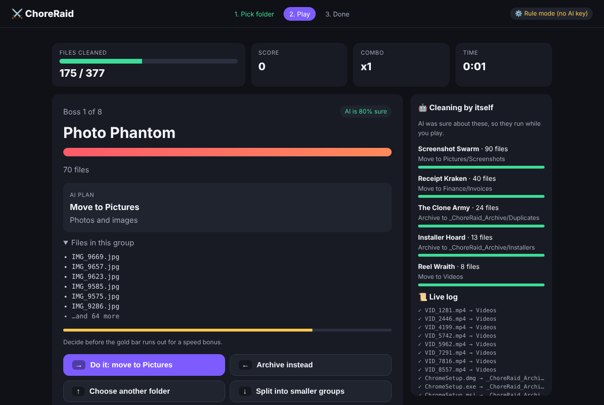
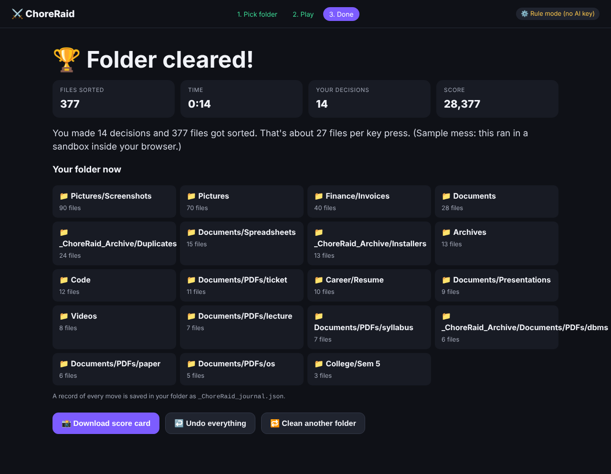
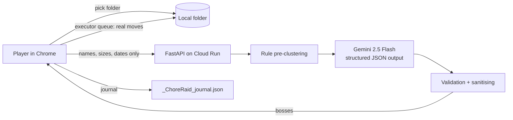

# ⚔️ ChoreRaid: clean your folder by playing a game

> **PromptWars × OUTLIER'26 · Challenge: Taskocalypse**
> "Build an experience where playing a fast-paced game actually executes the real-world chore in the background."

**ChoreRaid turns a messy folder into a boss fight. Every key you press really moves real files.**
One decision sorts hundreds of files, because Gemini groups the mess into "bosses" first.



## The problem

Everyone has a Downloads folder with 1,000+ files like `resume_FINAL_v7 (1).docx`.
Nobody cleans it, because the chore is **a thousand tiny decisions**.

Most "gamified" tools give you one swipe per file, so 5,000 swipes is still a chore.

## The insight

**Gamify only the decisions the AI is unsure about. Let it do the rest.**

| Step | What happens |
|---|---|
| 1. Pick a folder | Chrome's File System Access API gives the page access to the folder you choose |
| 2. AI plans | Only **file names, sizes and dates** go to the server. Files are pre-grouped by rules, then **Gemini** names each group, picks a target folder and gives a confidence score |
| 3. Background clean | Groups with confidence ≥ 85% clean themselves while you play |
| 4. Boss fights | Unsure groups become bosses. One key press resolves the whole group. Faster decisions earn combos |
| 5. Real execution | Files really move inside your folder. The boss HP bar drains as each file moves |
| 6. Undo | Every move is written to `_ChoreRaid_journal.json`. **Undo everything** restores every file |

In our 1,200-file demo (`scripts/make_mess.py`), the planner makes 15 bosses. 6 clean themselves, so **9 player decisions sort all 1,200 files** (over 130 files per key press).



## Controls

| Key | Button | Effect |
|---|---|---|
| → or D | Do it | Run the AI plan for this boss |
| ← or A | Archive instead | Move the group into `_ChoreRaid_Archive/` |
| ↑ or W | Choose another folder | Type your own target folder |
| ↓ or S | Split | Break the boss into smaller bosses (by month or name) |

Everything also works with mouse or touch.

## Architecture



- **Frontend:** vanilla HTML/CSS/JS with no build step. A single executor queue moves files. Player decisions jump ahead of background jobs.
- **Backend:** FastAPI with Pydantic validation. The `GEMINI_API_KEY` stays on the server.
- **AI:** Google Gemini (`gemini-2.5-flash`) through the `google-genai` SDK. It uses a response schema, so the output is always valid JSON. The prompt is in [`app/ai.py`](app/ai.py).
- **Resilience:** if Gemini times out (12 s) or fails, the rule labels are used and the game never breaks.

## Google AI usage

- **Gemini API** (from Google AI Studio) plans the cleanup: boss names, target folders, move or archive, and confidence.
- **Structured output** (`response_schema`) gives typed, safe JSON.
- **Cloud Run** hosts the app in one container.

## Security and privacy

- **File contents never leave the computer.** Only names, sizes and dates are sent.
- **Nothing is ever deleted.** "Archive" is a move into `_ChoreRaid_Archive/`.
- **Full undo** from the in-memory journal, with `_ChoreRaid_journal.json` kept as a record.
- **Name clashes** are never overwritten. A suffix like `(cr2)` is added.
- **AI output is never trusted blindly.** Target paths are sanitised (no `..`, no absolute paths, max 3 levels, safe characters). The action is limited to `move`/`archive`. Confidence is clamped.
- **Input limits:** Pydantic validates every request, with a 3,000-file cap and 255-character names.
- **Security headers:** `nosniff`, `DENY` framing and `no-referrer`. The container runs as a non-root user.
- **Copy fallback:** if `FileSystemHandle.move()` isn't available, the file is copied, its size is checked, and only then is the original removed.

## Accessibility

- The whole game is playable from the keyboard (arrow keys or WASD), with visible focus rings.
- `aria-live` regions announce each boss, its plan and the result.
- `prefers-reduced-motion` turns off animations.
- High-contrast dark theme and a responsive layout.

## Run locally

```bash
pip install -r requirements-dev.txt
cp .env.example .env              # add your GEMINI_API_KEY (optional, rule mode works without)
export GEMINI_API_KEY=your_key
uvicorn app.main:app --reload --port 8080
# open http://localhost:8080 in Chrome
```

Make a demo mess:

```bash
python scripts/make_mess.py demo_mess --count 1200
```

Or press **"Try a sample mess"** in the app. It builds a sandbox folder inside the browser and never touches your real files.

## Tests

```bash
pytest -q
```

The tests cover categorisation, path sanitising (traversal blocked), every file landing in exactly one group, splitting, validation of bad AI output (`delete` rejected, confidence clamped), and the API working without AI. The full browser flow was also tested end to end with Playwright: a 377-file sample was sorted and then completely restored by Undo.

## Deploy to Cloud Run

```bash
gcloud run deploy choreraid --source . --region asia-south1 \
  --allow-unauthenticated --set-env-vars GEMINI_API_KEY=YOUR_KEY
```

## Business model

| Tier | Price | What you get |
|---|---|---|
| Free | ₹0 | Local folder cleanup, unlimited |
| Pro | ₹99/month | Gmail, Google Drive and expense-statement modules, scheduled raids, saved rules |
| Teams | ₹499/seat/year | Shared-drive cleanup and retention policies for colleges and SMEs |

- **Growth:** the shareable score card ("1,214 files in 3:41") spreads on Instagram and LinkedIn at no cost.
- **Moat:** your decisions become personal rules, so the next raid is fully automatic.

## Roadmap

1. **Gmail raid:** bosses are senders and newsletters. Moves are archive, label or unsubscribe.
2. **Expense raid:** bosses are merchants. Moves are categorise or cancel the subscription.
3. **Lint raid:** bosses are lint rules. Moves apply AI fixes as a pull request.
4. **Learned rules:** player decisions become automatic rules for the next run.

Built solo by **Vedansh Mathur** for PromptWars × OUTLIER'26 at BML Munjal University.
